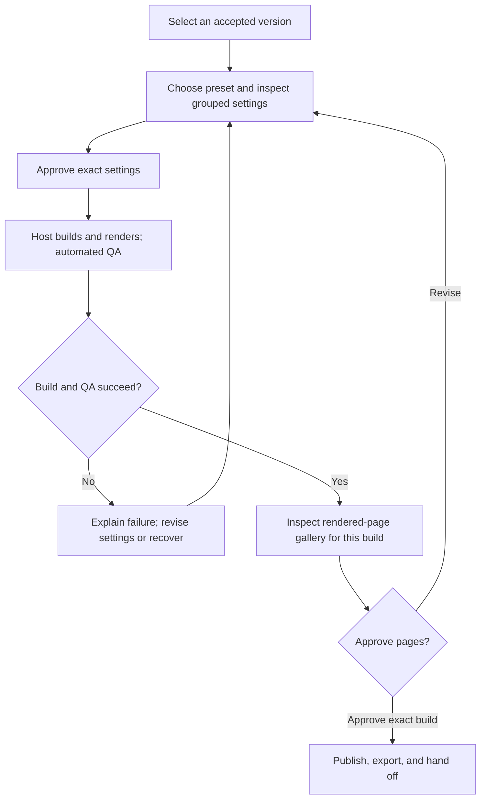

# Deterministic DOCX formatting: target interaction

**Status:** planned; owner request recorded 2026-11-08 after feasibility review

**Current behavior:** [UF-09](../flows/UF-09-format.md), agent-backed formatting

**Milestone:** [roadmap](../../../roadmap.md#deterministic-docx-formatting-in-the-studio)

This is a target, not a new native form or rendered-page gallery implemented by
the UX documentation change.

## Intended flow

## Settings interaction

A native settings gate replaces agent design proposals. Submission,
editorial-review, and reader-facing presets default from work metadata; fonts
come from those available to the chosen renderer. Existing settings validation
still applies. A receipt binds the exact approved settings.

Building runs as a worker job, one renderer instance at a time; a change creates
a new build directory, not silent replacement of reviewed pages.

## Page review

A human page-review gate replaces the agent's all-pages visual attestation.
The reviewer sees the rendered pages, QA findings, and page count, then approves
that exact build or returns to settings. Approval publishes/exports/hands off;
QA records the human receipt. Suggested automated checks: rendered PDF fonts
match settings, no blank pages, no stranded headings, and page count.

Use a grouped settings form and shared decision-panel page gallery. Do not
offer publication based only on settings approval or a different build's receipt.
The chosen screen location remains open: run management initially, or the
chapter viewer's future Formatted document entry.

## Boundaries and open decisions

- The built-in path removes agent prompts/attestation; edition identity no longer
  depends on a model/skill hash. The plugin skill remains independent.
- Whether an optional agent "suggest settings" button remains is undecided.
- English-only Contents labeling, refusal of scene-break rules (`***`, `---`),
  lists, images, code, and special forms such as poetry are recorded existing
  limits; supporting them or non-English output is not approved by this design.
- Word needs a Windows server; LibreOffice pagination may differ.
- Whether the external Documents-skill path remains is undecided.
- Domain content/order/heading/TOC/page checks and renderer stand-in tests remain
  implementation obligations in the roadmap, not new UX validation evidence.
