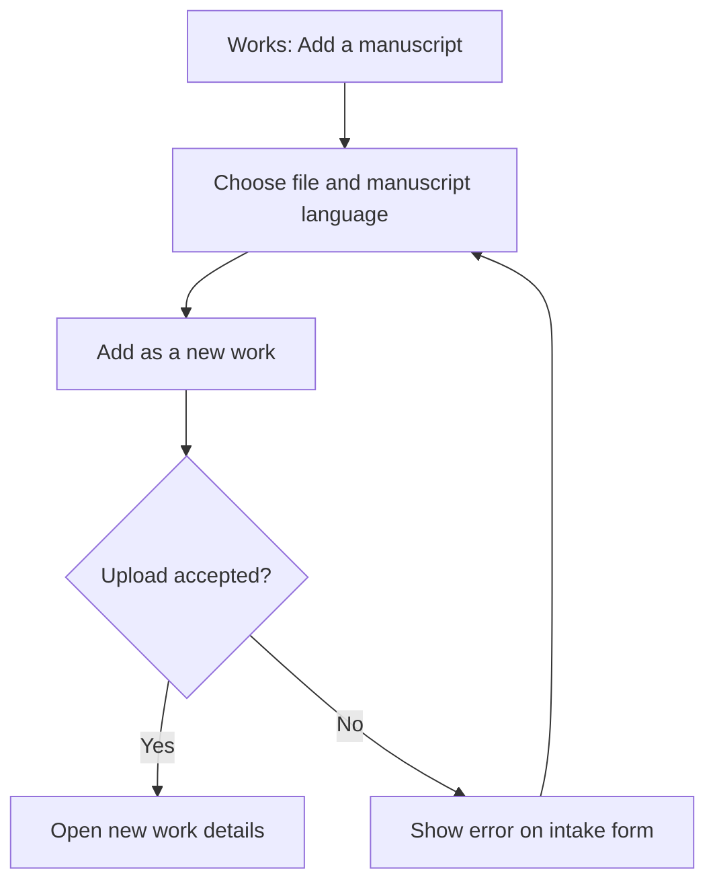

# UF-01 - Add a manuscript

- Feature: Works / intake.
- Actor: local manuscript owner.
- Entry: SC-01, Works.
- Preconditions: an accessible DOCX, Markdown, or text file and its language.
- Success: a distinct work exists and its details open.

## Current flow

## Alternatives and recovery

The submit button is unavailable without a file/language or while submitting.
Every upload creates a new work, even for identical bytes. Preparation does not
run during intake; it is the first workflow stage. PDF is not a current intake
format. A failed upload does not count as successful preparation.

## Target and open questions

Intake remains on Works in the [explorer design](../designs/studio-interface.md).
No deduplication, drag-and-drop redesign, or upload-progress design is approved here.

## Acceptance checks

- Empty library explains how to add the first work.
- Successful upload opens its work; a repeated upload creates another work.
- Failure shows an actionable error without claiming a work was prepared.

## Evidence

[SC-01](../screens/works.md); [Works.tsx](../../../studio/frontend/src/views/Works.tsx).
Existing API case: [works-intake-multiple-001](../../../studio/tests/cases/works-intake-multiple-001/case.json).
Source-mapped only in this migration; the case was not rerun for UX validation.
