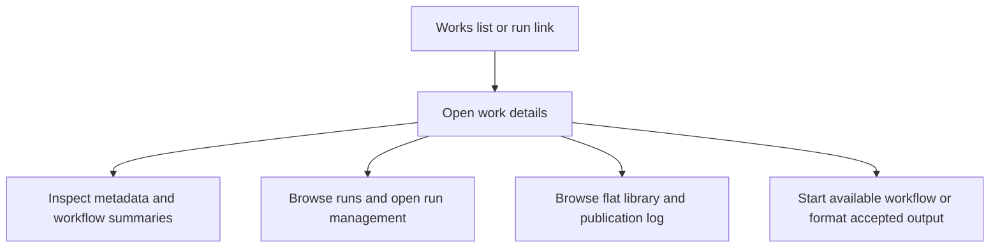

# UF-02 - Browse a work

- Feature: Works / artifact library.
- Actor: local owner or reviewer.
- Entry: Works list, or a run's work link.
- Preconditions: a work exists; no run is required.
- Success: the user identifies its source, metadata, runs, and published outputs.

## Current flow

## Alternatives and recovery

A work without runs still has a details page. No finalized workflow or accepted
publication produces explanatory empty text or hides dependent controls.
An unfinished run is linked and prevents another run starting on that work.
Loading/artifact errors are displayed; there is no work-deletion flow.

## Target and open questions

[Version-oriented exploration](../designs/studio-interface.md) is planned:
overview/metadata, versions, runs, and library/log sections. Current browsing is
not yet a workflow-to-version-to-files hierarchy or accepted-version reader.

## Acceptance checks

- Work details are reachable without entering a run.
- Source identity, active run, and accepted-version lineage are distinguishable.
- Empty work state does not imply missing preparation is an intake failure.

## Evidence

[SC-02](../screens/work-details.md); [Works.tsx](../../../studio/frontend/src/views/Works.tsx).
The [intake API case](../../../studio/tests/cases/works-intake-multiple-001/case.json)
is a starting point, not proof of the proposed explorer design.
