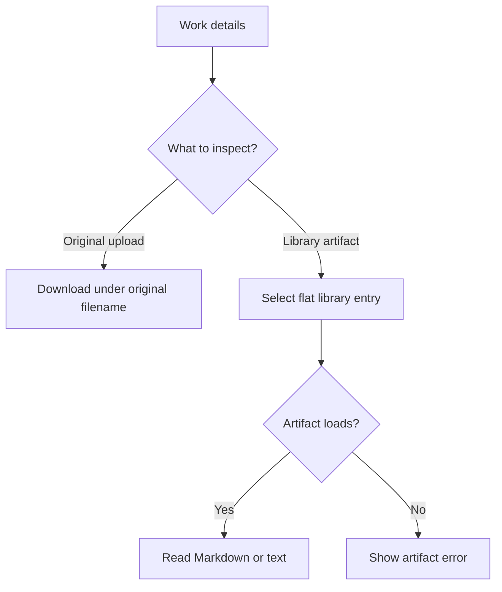

# UF-03 - Retrieve source and artifacts

- Feature: Works / reading and retrieval.
- Actor: local owner or reviewer.
- Entry: work details, source link, or library.
- Preconditions: a stored source or published artifact.
- Success: the original downloads, or a supported library artifact is read.

## Current flow

## Alternatives and recovery

The original file is downloaded rather than embedded; prepared text is read in
the chapter viewer. Run management displays export/DOCX filesystem locations.
This is not a general browser download flow for accepted-version ZIPs or binary
formatted artifacts. There is no current native source preview.

## Target and open questions

The [explorer design](../designs/studio-interface.md) adds version downloads and
source preview. These remain targets, not hidden capabilities of the library.

## Acceptance checks

- Original filename and bytes are retained in the download.
- Reading a library entry cannot edit manuscript text.
- An unavailable artifact produces an error rather than an empty successful view.

## Evidence

[SC-02](../screens/work-details.md); [Works.tsx](../../../studio/frontend/src/views/Works.tsx);
[test_web.py](../../../studio/tests/test_web.py),
`test_original_upload_downloads_under_its_name`.
