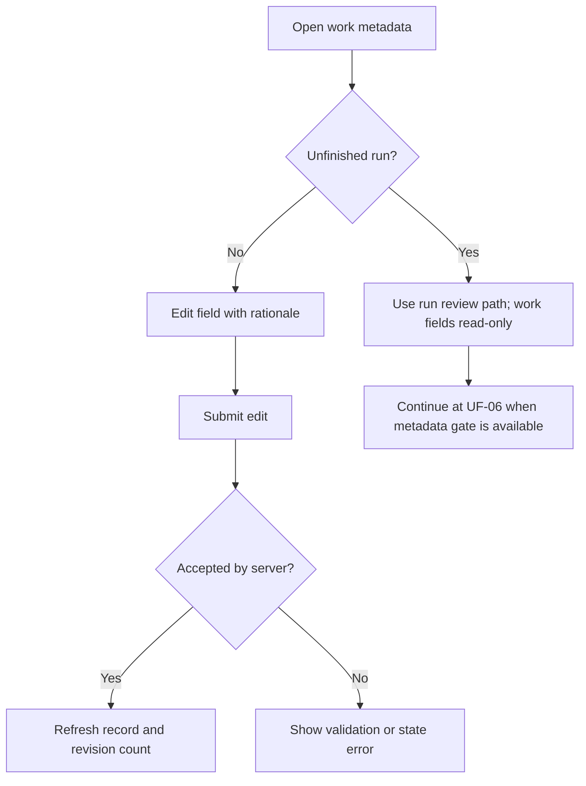

# UF-04 - Maintain work metadata

- Feature: shared metadata.
- Actor: local manuscript owner.
- Entry: work details, or the active run's metadata review.
- Preconditions: a metadata record; edits allowed for the current state/field.
- Success: an attributable new metadata revision is saved.

## Current flow

## Alternatives and recovery

An initial author form is available before the first run. Active-turn/locked-field
restrictions apply server-side. During an unfinished run the work page is not an
escape around those restrictions. An edited metadata title does not rewrite
prepared manuscript text. The page exposes a revision/history count, not a
full metadata-version comparison browser.

## Target and open questions

Metadata comparison belongs to the [explorer target](../designs/studio-interface.md).
See [UXD-001](../decisions/UXD-001-interaction-contracts.md) for shared record rules.

## Acceptance checks

- Record revision and edit rationale are distinguishable from manuscript changes.
- Locked or conflicting edits fail without bypassing the active run.
- Changing metadata does not silently update a prepared title heading.

## Evidence

[SC-02](../screens/work-details.md), [SC-06](../screens/decision-panel.md);
[Metadata.tsx](../../../studio/frontend/src/views/Metadata.tsx);
[service.py](../../../workflow/src/service.py). API tests are not a metadata-diff UI.
