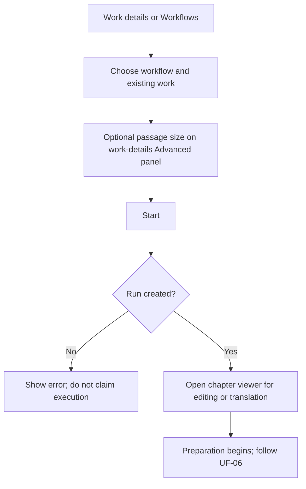

# UF-05 - Start a workflow

- Feature: workflow launch.
- Actor: local manuscript owner.
- Entry: work details or Workflows dashboard.
- Preconditions: an existing work without an unfinished run.
- Success: a run is created, starts automatically, and opens its landing view.

## Current flow

## Alternatives and recovery

Works with unfinished runs are unavailable for another launch; the work-details
start panel is hidden while busy. Formatting is derived from accepted output
and uses [UF-09](UF-09-format.md), not this generic form. Only work-details launch
exposes the Advanced passage-size field; the dashboard does not yet have parity.
No runtime/model picker exists in this branch's web UI.

## Target and open questions

The [interface record](../designs/studio-interface.md) retains both entry points.
Parity of advanced settings is an open UX question, not an approved change.

## Acceptance checks

- Launch never uploads a second source implicitly.
- Busy-work conflicts remain enforced by the server, not just disabled options.
- A valid passage-size choice is fixed for the run and retained on workflow restart.

## Evidence

[SC-02](../screens/work-details.md), [SC-03](../screens/workflows.md);
[Works.tsx](../../../studio/frontend/src/views/Works.tsx),
[Runs.tsx](../../../studio/frontend/src/views/Runs.tsx).
