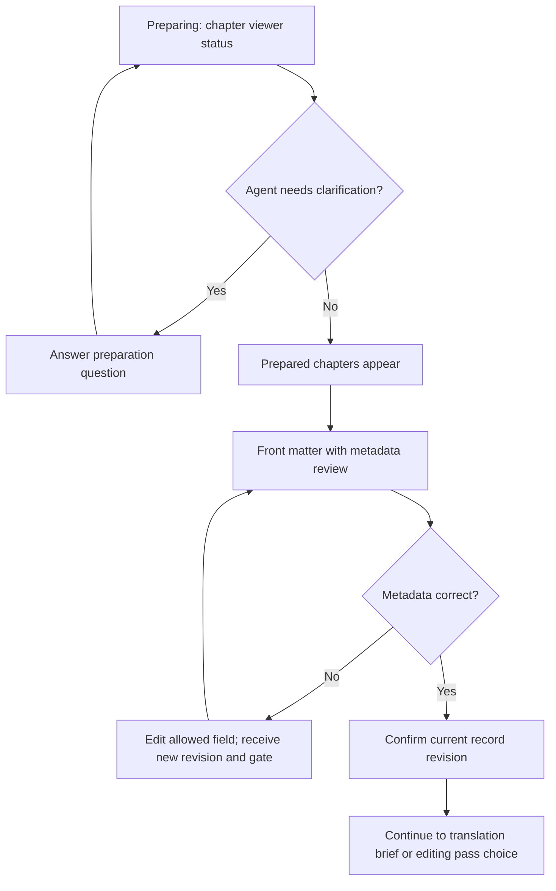

# UF-06 - Prepare and confirm metadata

- Feature: shared preparation and input review.
- Actor: local owner/reviewer, with an agent doing preparation.
- Entry: newly started editing or translation run.
- Preconditions: source is stored and execution tools are available.
- Success: preparation is verified and the current metadata revision confirmed.

## Current flow

## Alternatives and recovery

Before chapters exist, a question may be the viewer's only content. Failed or
blocked preparation links to run management. Exactly one front-matter unit
anchors metadata review. A missing source title can be supplied from metadata,
document properties, then filename; the viewer labels its basis and evidence.
A correction to prepared title text requires restarting preparation.

## Target and open questions

The [front-matter design record](../designs/studio-interface.md) explains the
owner decisions; none requires a new general manuscript editor.

## Acceptance checks

- Confirmation binds the visible gate and metadata record revision.
- An edit invalidates the previous confirmation target.
- A supplied title is visible as supplied, not misrepresented as verbatim source.

## Evidence

[SC-05](../screens/chapter-viewer.md), [SC-06](../screens/decision-panel.md);
[GatePanel.tsx](../../../studio/frontend/src/views/GatePanel.tsx).
Existing API coverage starts in [test_web.py](../../../studio/tests/test_web.py),
`test_translation_runs_through_every_gate_from_the_browser_api`.
