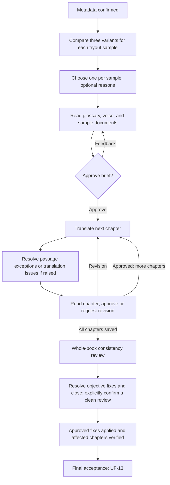

# UF-07 - Translate a manuscript

- Feature: literary translation to the template's English target.
- Actor: local reviewer working with the translator agent.
- Entry: confirmed preparation/metadata, UF-06.
- Preconditions: translation run and executable runtime.
- Success: accepted chapter output is exported as an immutable version.

## Current flow

## Alternatives and recovery

Sample choices guide voice, not mandatory wording for later passages. Brief
corrections return to the translator; the UI does not edit its files directly.
An oversized passage requires approval for its exact range. Chapter approval
can be a direct command when no edits are proposed or a sheet with explicit closure.
Consistency reviews terminology, address, voice, and cross-chapter references,
not general restyling. Findings link back to chapters; there is no dedicated
selectable whole-book reading page yet. Retry/restart use UF-17.

## Target and open questions

[Aligned source/output and whole-book reading](../designs/studio-interface.md)
remain distinct targets. Their absence must not be hidden by this high-level flow.

## Acceptance checks

- Every chapter approval concerns the bound saved draft, not an unsaved candidate.
- Final acceptance is unavailable before consistency closure and fix verification.
- Restarting a chapter invalidates affected consistency review; restarting
  consistency preserves the completed chapter outputs.

## Evidence

[SC-05](../screens/chapter-viewer.md);
[translation template](../../../workflow/templates/literary-translation-v1/template.json);
[TranslationEngine](../../../workflow/src/translation.py).
The [Beijing-night case](../../../studio/tests/cases/beijing-night-translation-gui-001/case.json)
is a live opt-in case, not a newly executed UX walkthrough.
