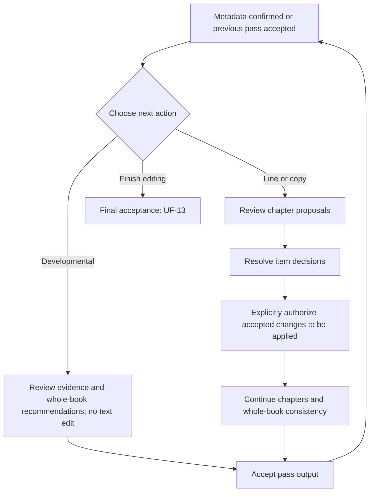

# UF-08 - Edit a manuscript

- Feature: literary editing.
- Actor: local author/reviewer working with the editor agent.
- Entry: confirmed preparation/metadata, UF-06.
- Preconditions: editing run; initial input text is the uploaded work.
- Success: chosen passes are accepted and the user finalizes the resulting text.

## Current flow

## Alternatives and recovery

Passes can repeat in any order, including the same pass again. Final acceptance
can follow metadata with zero passes. Accepting a pass is not irreversible final
acceptance; it makes its text/editorial files the next pass's input. There is no
discard-pass action: restart the stage before accepting a pass to redo it.
Resolving all editorial items closes that review implicitly, but does not replace
the explicit apply authorization. A revision request reopens work.

## Target and open questions

The [studio design](../designs/studio-interface.md) calls for whole-book reading
pages and editing diffs. The implemented shared viewer displays current editing
text, not a complete change-tracking editor. Developmental workflow completeness
and live coverage remain M4 concerns; documenting a selector does not close M4.

## Acceptance checks

- The user, not a fixed developmental-line-copy sequence, chooses passes.
- Pass review, application, pass acceptance, and final acceptance stay distinct.
- No new pass can run after final acceptance.

## Evidence

[SC-05](../screens/chapter-viewer.md), [SC-06](../screens/decision-panel.md);
[editing template](../../../workflow/templates/literary-editing-v1/template.json);
[EditingEngine](../../../workflow/src/editing.py).
[Workflow tests](../../../workflow/tests/test_workflow.py) contain deterministic
editing checks; historical live evidence and its limits remain in the roadmap.
