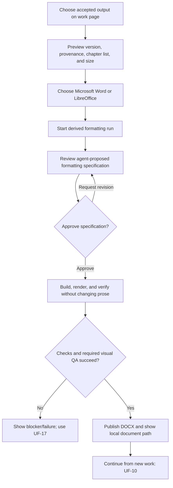

# UF-09 - Format an accepted version

- Feature: derived manuscript formatting.
- Actor: local owner/reviewer working with the formatter agent.
- Entry: work-details Format as DOCX panel or finalized run's formatting shortcut.
- Preconditions: accepted Markdown publication, no unfinished run on the work,
  and the configured document backend/rendering/QA capabilities.
- Success: verified DOCX is published/exported and handed off as a new work.

## Current flow

## Alternatives and recovery

The finalized-run shortcut defaults to Word; other renderer/version choices are
on the work page. A version must be selected and previewed before the Format
button enables. No accepted publication means no formatting panel.
Current formatting is agent-backed. The studio's built-in backend is not the
same as the plugin's external Documents-skill path. Word needs Windows;
LibreOffice pagination can differ. Unsupported content/capabilities block rather
than count as a visually verified edition.

## Target and open questions

[Deterministic formatting](../designs/deterministic-formatting.md) proposes a
native settings form and human rendered-page approval without an agent.
Neither that settings gate nor a page-review gallery is current.

## Acceptance checks

- The selected accepted version, not an in-progress chapter, is the input.
- Text/order/heading/TOC/page checks and required visual QA precede publication.
- No new edition is presented as complete when its renderer is missing.

## Evidence

[SC-02](../screens/work-details.md), [SC-04](../screens/run-management.md);
[formatting template](../../../workflow/templates/manuscript-formatting-v1/template.json);
[FormattingEngine](../../../workflow/src/formatting.py).
Renderer stand-ins in [workflow tests](../../../workflow/tests/test_workflow.py)
do not establish actual Word/LibreOffice availability.
