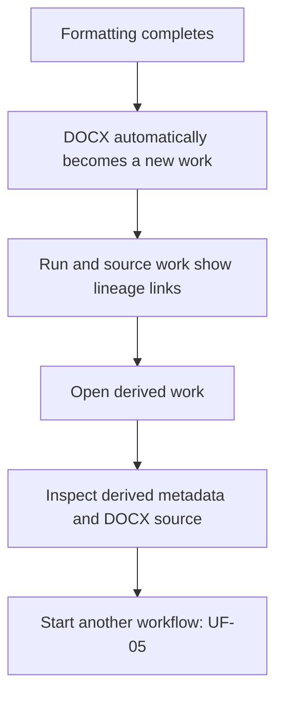

# UF-10 - Continue from a formatted edition

- Feature: work lineage and continuation.
- Actor: local manuscript owner.
- Entry: completed formatting run or originating work's lineage links.
- Preconditions: successful formatting and hand-off.
- Success: the formatted output's new work is opened for further workflows.

## Current flow

## Alternatives and recovery

This is automatic hand-off, not a separate user Upload action or in-place source
replacement. Derived metadata is not a blind copy: use the formatted front
matter's title, appropriate language-neutral facts, and original language;
language-specific descriptive text can be inferred during new preparation.
The next workflow still prepares and confirms its own metadata.

## Target and open questions

The [hand-off decision](../designs/studio-interface.md) covers formatted
translations linked to their origin. It does not implement a generic
cross-work conversion/linking UI for arbitrary nonformatted manuscripts.

## Acceptance checks

- Origin and new work remain separately identifiable.
- Further editing cannot mutate the original accepted translation version.
- The new work can enter a workflow under the same one-unfinished-run rule.

## Evidence

[SC-02](../screens/work-details.md), [SC-04](../screens/run-management.md);
[Works.tsx](../../../studio/frontend/src/views/Works.tsx);
[service.py](../../../workflow/src/service.py).
Historical hand-off evidence is retained with formatting/M4 progress in the roadmap.
