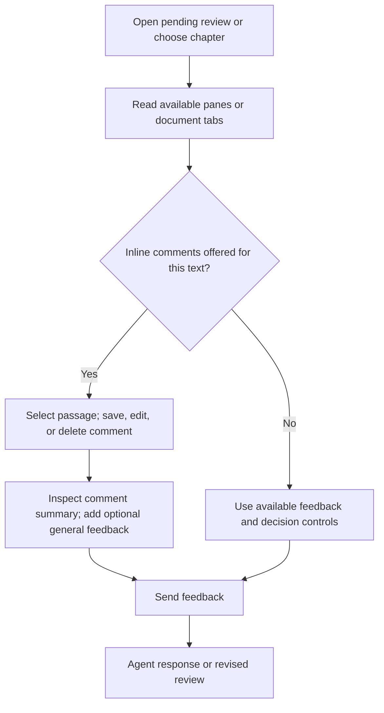

# UF-11 - Review chapters and documents

- Feature: contextual reading and feedback.
- Actor: local reviewer.
- Entry: chapter list, pending-review notice, or document-review gate.
- Preconditions: prepared text or a bound review document exists.
- Success: the user reads the relevant evidence and explicitly submits feedback.

## Current flow

## Alternatives and recovery

Translation shows original beside translation; editing shows current edited
text or the original before a pass changes it. Commentable translation drafts
and brief documents use browser-local draft storage keyed to the review.
Highlighting without a written note is not sent. Source text is read-only.
After a successful submission, prior-review feedback must not leak into the
next gate. A failed feedback submission retains the current feedback draft.
Before preparation, there may be only status or a question.

## Target and open questions

[Paragraph alignment, per-stage versions, and editing diffs](../designs/studio-interface.md)
are targets. A side-by-side layout is not already paragraph alignment.
Browser-local drafts are not shared across devices or authenticated users.

## Acceptance checks

- Reading and annotating never directly edits manuscript content.
- Comments retain quote/range/paragraph context and go to the intended review.
- Navigation/new gates cannot silently turn old feedback into a new decision.

## Evidence

[SC-05](../screens/chapter-viewer.md);
[CommentableText.tsx](../../../studio/frontend/src/views/CommentableText.tsx);
[test_cases.py](../../../studio/tests/test_cases.py),
`test_feedback_stays_with_its_review` (browser opt-in).
