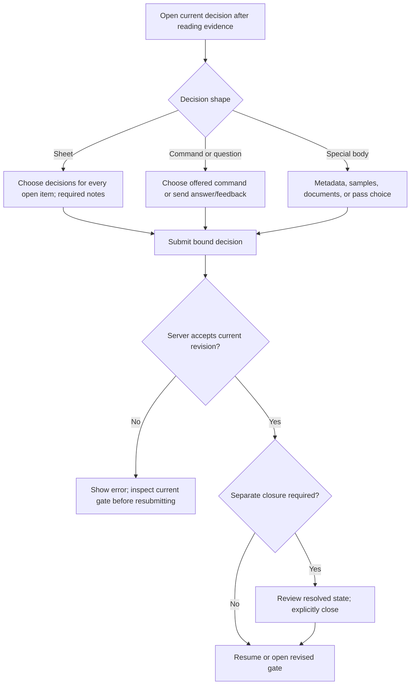

# UF-12 - Resolve an approval gate

- Feature: shared decision interaction.
- Actor: local reviewer.
- Entry: a pending human-review gate.
- Preconditions: current gate/sheet revision and its bound evidence.
- Success: an explicit validated disposition is saved and execution can continue.

## Current flow

## Alternatives and recovery

Sheet decisions require every open item and required notes. UI drafts are keyed
by run/sheet/revision. Advice/map exceptions and editorial reviews may close
implicitly when every item resolves; reopening feedback produces another revision.
Chapter approval, consistency closure, editorial application, pass acceptance,
and final acceptance remain distinct. Confirming a clean consistency review
also requires an explicit action. Final acceptance is UF-13, not a generic reply.

## Target and open questions

[Unified frame and closure styling](../designs/studio-interface.md) are partially
implemented. Special bodies remain. Review draft durability on rejected sheet
submission/reload separately; feedback-isolation tests do not prove every body's
storage behavior. This is an open validation question, not an approved redesign.

## Acceptance checks

- Stale/unknown/duplicate IDs or missing required notes cannot pass a gate.
- Feedback and "continue" cannot substitute for an exact approval.
- Resolved items are not made actionable again without reopening.

## Evidence

[SC-06](../screens/decision-panel.md);
[GatePanel.tsx](../../../studio/frontend/src/views/GatePanel.tsx);
[SheetReview.tsx](../../../studio/frontend/src/views/SheetReview.tsx);
[approval parser tests](../../../plugins/manuscript-studio/skills/review-approval-sheet/scripts/test_approval_review.py).
