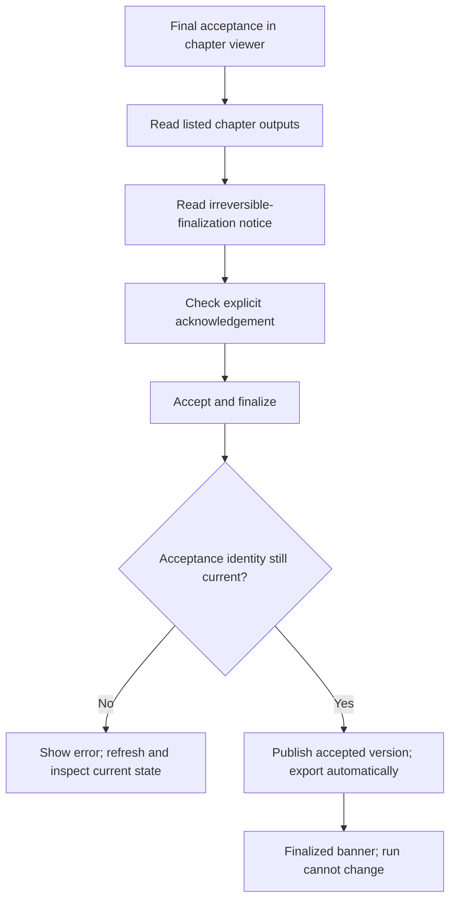

# UF-13 - Accept and finalize

- Feature: irreversible final acceptance for editing/translation.
- Actor: local reviewer.
- Entry: run reaches WAITING_FOR_ACCEPTANCE.
- Preconditions: required workflow work and review closures are complete.
- Success: immutable accepted version is published and automatically exported.

## Current flow

## Alternatives and recovery

The accept button stays disabled until acknowledgement. The server validates
the acceptance identity and required explicit confirmation. Delaying acceptance
does not cancel a run; recovery actions remain governed by available_actions.
A finalized run's chapter/stage/workflow cannot be restarted. A subsequent run
on the same work publishes the next version (UF-14); re-upload is not required.

## Target and open questions

Consistent irreversible-action presentation is in the
[studio design](../designs/studio-interface.md). Formatting's proposed human
page acceptance is a separate target, not this current chapter-output gate.

## Acceptance checks

- The notice precedes acceptance and acknowledgement cannot be omitted.
- Finalized output is read-only and remains identifiable after another run.
- Acceptance does not claim a browser download: current export is local.

## Evidence

[SC-05](../screens/chapter-viewer.md), [SC-06](../screens/decision-panel.md);
[GatePanel.tsx](../../../studio/frontend/src/views/GatePanel.tsx);
[test_web.py](../../../studio/tests/test_web.py),
`test_translation_runs_through_every_gate_from_the_browser_api`.
