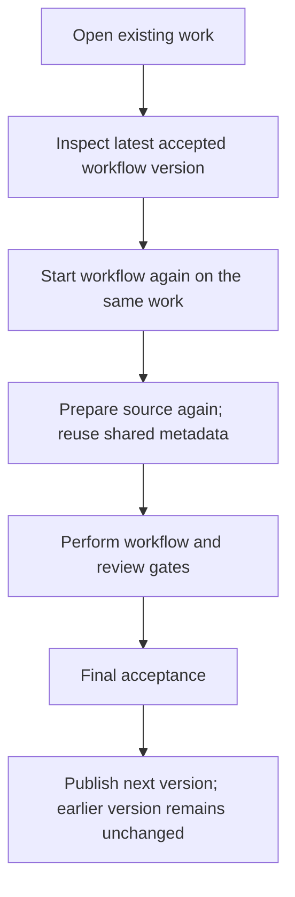

# UF-14 - Publish the next version

- Feature: accepted-output versioning.
- Actor: local manuscript owner.
- Entry: a work with a completed editing/translation run.
- Preconditions: no unfinished run on that work.
- Success: a new run publishes another immutable version without altering the old.

## Current flow

## Alternatives and recovery

A completed run does not block another run. The prior accepted output is not
silently substituted for the work's immutable source. To edit a formatted
translation as input, use its handed-off new work (UF-10), or upload the desired
text as a new work. The work page lists publications; it is not yet a complete
accepted-version reading/comparison interface.

## Target and open questions

[Workflow-to-version-to-files browsing](../designs/studio-interface.md) and an
accepted-version viewer are planned. Domain immutability stays unchanged.

## Acceptance checks

- A new run on the same work is possible after completion.
- The user can distinguish latest workflow summary from earlier publications.
- New work does not rewrite previous accepted artifacts or decisions.

## Evidence

[SC-02](../screens/work-details.md);
[Works.tsx](../../../studio/frontend/src/views/Works.tsx);
[service.py](../../../workflow/src/service.py);
[UXD-001](../decisions/UXD-001-interaction-contracts.md) records the correction
to the original new-upload-only finalization wording.
