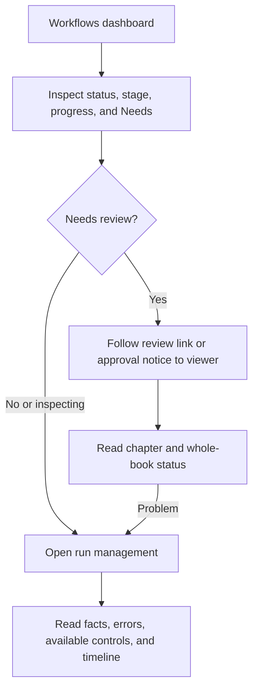

# UF-15 - Monitor execution

- Feature: cross-work dashboard and run inspection.
- Actor: local owner/reviewer.
- Entry: Workflows list, work's run table, or chapter viewer status link.
- Preconditions: a run exists.
- Success: the user understands state, progress, next decision, and recovery options.

## Current flow

## Alternatives and recovery

Server-sent change fingerprints refresh relevant data; a snapshot fallback
handles a silent/buffered stream. The timeline loads new visible events.
The dashboard has no workflow/status/needs-me filters yet. The timeline is an
event list, not a readable receipt-history browser. No token-usage panel exists
on this branch. Whole-book completion is distinct from translated chapter count.

## Target and open questions

The [inspector design](../designs/studio-interface.md) adds more readable decision
history and separates all decisions from inspection. Formatting still uses the
run page for decisions until a preview exists.

## Acceptance checks

- A human gate or problem exposes its next action, not just a status code.
- Background refresh does not falsely imply a new user decision.
- Current and finalized output states remain distinguishable.

## Evidence

[SC-03](../screens/workflows.md), [SC-04](../screens/run-management.md);
[test_cases.py](../../../studio/tests/test_cases.py),
`test_run_page_follows_the_change_feed_instead_of_polling`;
[test_web.py](../../../studio/tests/test_web.py),
`test_change_feed_reports_only_real_changes`.
