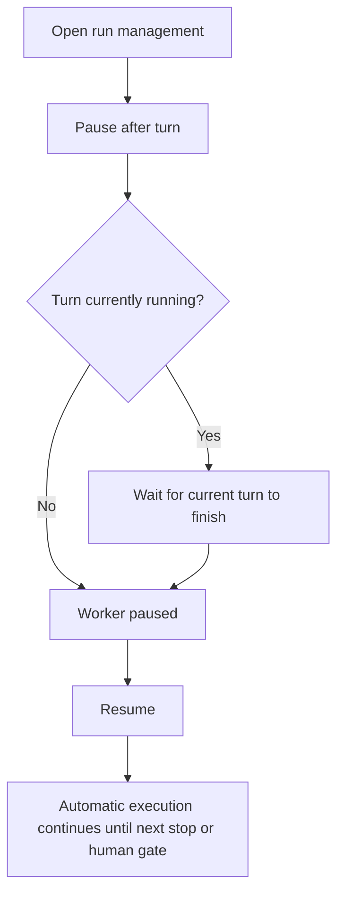

# UF-16 - Pause and resume

- Feature: automatic-execution controls.
- Actor: local owner/reviewer.
- Entry: an unfinished run's management controls.
- Preconditions: a nonterminal run; a current agent turn may still be working.
- Success: automatic work pauses at a saved boundary, then resumes safely.

## Current flow

## Alternatives and recovery

Pause is not an immediate process interrupt or rollback. A human gate is not
approved by Resume; its decision remains required. Terminal runs do not offer
Pause/Resume. UI worker-paused state is distinct from an agent failure and may
not be identical to the durable run status label.

## Target and open questions

[UXD-001](../decisions/UXD-001-interaction-contracts.md) records why immediate
interrupt was removed from M3. It remains a later possibility, not this flow.

## Acceptance checks

- The button explicitly communicates "after turn."
- Work already saved remains available while paused.
- Resume cannot bypass an outstanding human decision.

## Evidence

[SC-04](../screens/run-management.md);
[RunView.tsx](../../../studio/frontend/src/views/RunView.tsx);
[worker.py](../../../studio/server/worker.py).
No new turn-interruption or pause-timing experiment is claimed by this document.
