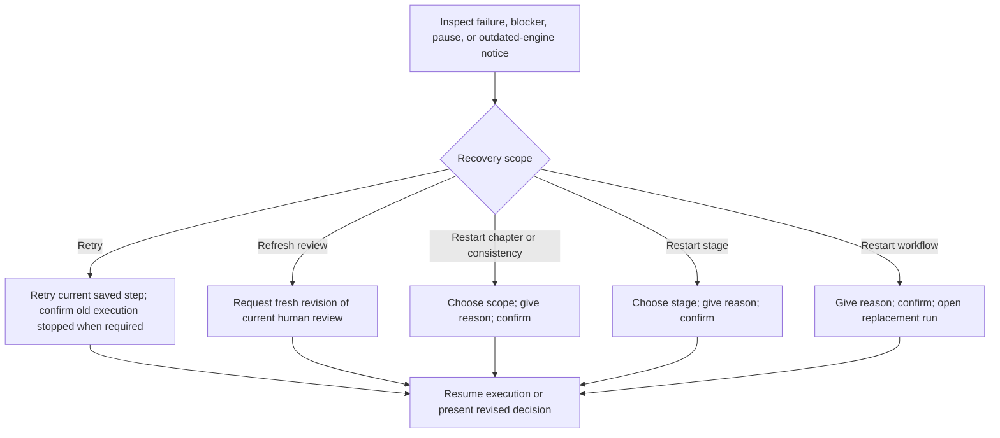

# UF-17 - Recover or restart

- Feature: scoped recovery and review refresh.
- Actor: local owner/reviewer.
- Entry: viewer problem link or run-management error/controls.
- Preconditions: the requested action is enabled by available_actions.
- Success: the intended saved operation resumes or only the explicitly chosen scope is redone.

## Current flow

## Alternatives and recovery

Retry starts from saved state, not a checkpoint rollback. Restarting a chapter
archives/redoes that scope and invalidates affected downstream review; consistency
restart keeps completed chapter text. Restarting an unfinished workflow retains
history/receipts and links the replacement run. An engine-code mismatch permits
reading and workflow restart, not ordinary continuation. Finalized runs cannot
be restarted; create another run/version instead.

## Target and open questions

Readable decision history and clearer scope/retained-work explanations are in
the [inspector design](../designs/studio-interface.md). Current confirmations
include browser prompt/confirm dialogs, not redesigned inline recovery forms.

## Acceptance checks

- Disabled actions expose the server's reason and cannot be forced through UI state.
- A retry never acts as an approval; refreshed gates invalidate old submissions.
- A replacement run is navigable and the original history remains inspectable.

## Evidence

[SC-04](../screens/run-management.md);
[RunView.tsx](../../../studio/frontend/src/views/RunView.tsx);
[workflow tests](../../../workflow/tests/test_workflow.py).
Existing domain tests do not prove every prompt/confirmation is usable.
