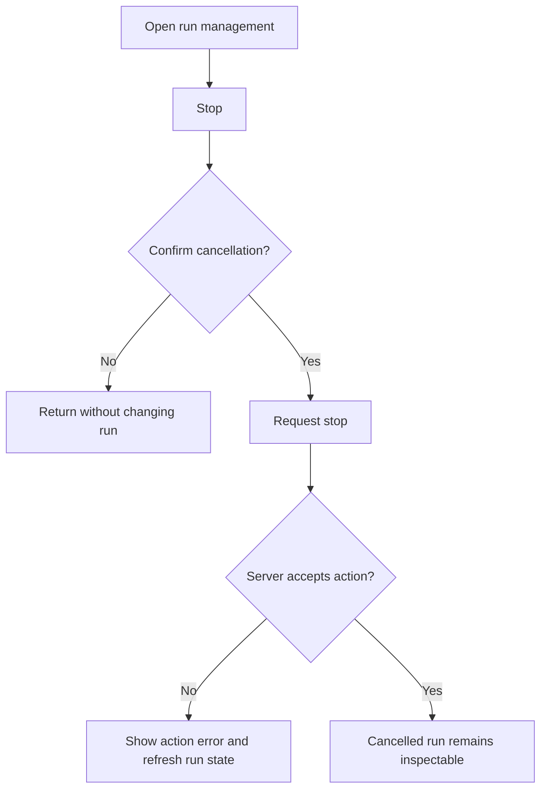

# UF-18 - Stop a workflow

- Feature: cancellation.
- Actor: local owner/reviewer.
- Entry: unfinished run's management controls.
- Preconditions: Stop is enabled by available_actions.
- Success: the run is cancelled; saved artifacts and history remain.

## Current flow

## Alternatives and recovery

Stop is not Pause and is not a delete operation. It does not erase the work,
source, or publication history. It is governed by the engine's enabled actions
and must not be presented as immediate force-termination of an in-flight process.
Finalized output cannot be cancelled into an editable state.

## Target and open questions

The [shared irreversible-action style](../designs/studio-interface.md) is a
design target. Do not invent a delete/undo/reopen action for a cancelled or final run.

## Acceptance checks

- Dismissing confirmation leaves the run unchanged.
- Invalid/stale stop requests refresh the visible state and show the failure.
- Cancellation and acceptance/finalization have distinct language and outcomes.

## Evidence

[SC-04](../screens/run-management.md);
[RunView.tsx](../../../studio/frontend/src/views/RunView.tsx);
[service.py](../../../workflow/src/service.py);
[engine.py](../../../workflow/src/engine.py). Process timing is not tested here.
