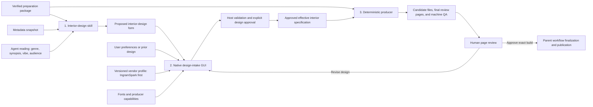
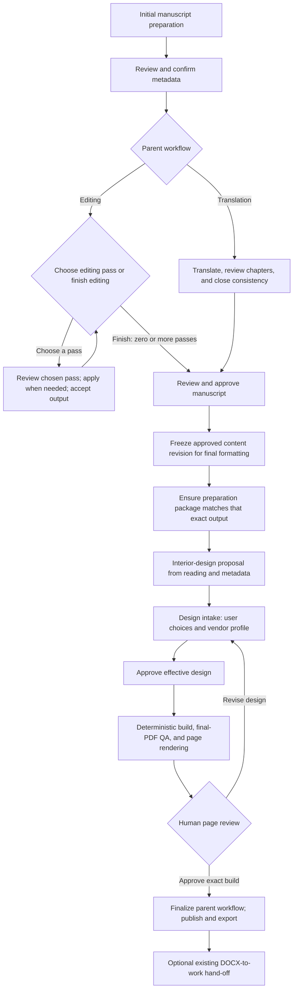

# High-level design: interior design and deterministic production

**Version:** 0.1 draft, 2026-11-13.

**Status:** partially implemented: the proposal-only skill/schema/helper are
implemented in this branch, with a literary-editing proposal route and editable
human review gate. Vendor-aware effective intake, embedded production integration,
and the remaining architecture are not implemented or approved in full.

**Requirement basis:** the owner's three-component direction and correction:
formatting consumes the results of manuscript preparation and is embedded in
literary editing and translation, not offered as an independent workflow.
In literary editing, zero editing passes remain allowed, but the manuscript must
be approved before formatting starts as the last phase. There is no early
interior-design/Format action (owner revision, 2026-11-15; IDP-C11).
The interior-design skill itself is workflow-neutral and supports standalone
invocation (owner clarification, 2026-11-14). Embedded formatting and approval
routing are orchestration rules, not restrictions on using the skill.

**Tool boundary:** IDP-C23 confirms an installable formatter with a Python API
and CLI under `tools/formattor`, with workflow as a consumer. This tool is not
an independent public Studio workflow. Design/gap documents now live beside
the tool; executable intake/generation and packaging remain unimplemented.

**Delivery tracking:** [roadmap](../../../roadmap.md#deterministic-docx-formatting-in-the-studio).
The earlier [gap analysis](deterministic-docx-gap-analysis.md) remains a baseline
code audit; its standalone/accepted-output/fully-agent-free framing is superseded.

## Requirement traceability and change control

This register separates explicit owner requirements from the proposed architecture.
All requirements below are **owner-confirmed**. Implementation is tracked below;
the verification column describes the evidence required, not automatic completion.
Do not renumber IDs, infer full-design approval, or promote a requirement to
implemented based on a diagram or the earlier baseline tests.

Current implementation evidence:

- IDP-R01: the installed skill is now
  [interior-design](../../../plugins/manuscript-studio/skills/interior-design/SKILL.md),
  with updated installer/listing references. The obsolete formatter skill,
  generator/template and public launch paths are removed (IDP-C12).
- IDP-R02/IDP-R03: implemented
  [proposal schema](../../../plugins/manuscript-studio/skills/interior-design/schemas/interior-design-proposal.schema.json),
  [example](../../../plugins/manuscript-studio/skills/interior-design/references/proposal.example.json),
  and [validation tests](../../../plugins/manuscript-studio/skills/interior-design/scripts/test_validate_proposal.py).
  Evidence covers instructions, shape, internal references, and optional local
  preparation binding: 17 proposal tests pass. Installer/listing checks have
  31 passes and three platform-dependent skips. None is a live-model
  design-quality evaluation.
- IDP-R04/IDP-R07/IDP-R08/IDP-R09/IDP-R14/IDP-R15: partial embedded implementation in
  [the literary-editing template](../../../workflow/templates/literary-editing-v1/template.json),
  [phase coordinator](../../../workflow/src/interior.py), and
  [editable form](../../../studio/frontend/src/views/InteriorDesignReview.tsx).
  Manuscript approval after zero or more accepted passes starts the final
  formatting phase automatically, reaching proposal authoring, exact
  preparation checks, revisioned human edits and proposal approval. This is not
  vendor-aware effective-spec approval or completed production. Translation
  integration and IDP-R06 remain pending; profile selection is implemented below,
  but vendor/producer effective-spec compilation remains pending.
- IDP-R05/IDP-R17: the bundled
  [IngramSpark profile](../../../plugins/manuscript-studio/skills/interior-design/profiles/ingramspark.json)
  has paperback/hardcover variants, automatically resolved from binding after
  choosing one IngramSpark vendor option. The proposal includes the exact
  versioned data and canonical hash. Selection before authoring and later
  read-only target presentation are implemented. Source rules are distinct from
  Studio guidance; incomplete custom-trim coverage and safety recommendations
  produce advisories, not universal vendor prohibitions. Native browser checks
  cover both variants, automatic switching at entry, proposal propagation and
  fixed target fields while saving font/gutter edits. Final product availability, effective
  production capabilities and rendered-output compliance remain unverified.
- IDP-R16: the work-page/completed-run launchers, legacy formatter engine/template,
  adapter skill and CLI/E2E formatting options are removed. Unsupported historical
  runs use a generic read-only archive view, not a compatibility executor.
  Their recorded status, decisions and artifacts remain unchanged; they cannot
  present active `format_spec` sheets or block a supported new run.
  Evidence: removal/read-only/reindex/API rejection tests are part of 73 passing
  workflow/API tests. Thirty preparation, 25 preparation-evaluation and 31
  installer checks pass (three platform skips). Browser checks exercise the
  actual work-page entrypoint through manuscript approval to the native form,
  and inspect the live legacy page/work/completed-run launch locations read-only.
  Live run revisions/state hashes remain unchanged. No model/renderer evaluation
  or human design/page approval is implied.

| ID | Owner-confirmed requirement | Design location | Required verification |
| --- | --- | --- | --- |
| IDP-R01 | Convert the original formatting skill into an interior-design skill. | Section 4 | Converted skill and all references are consistent; it does not construct output documents. |
| IDP-R02 | Skill inputs include manuscript, metadata, and agent reading such as genre, synopsis, and vibe. | Sections 3-4 | Proposal records the exact prepared text, metadata, and reading basis. |
| IDP-R03 | Skill output is an interior-design specification form, including fonts, line spacing, and related choices. | Section 4 | Structured form validates and retains explicit values, units, and rationale. |
| IDP-R04 | Native GUI intake accepts the design result as one of its inputs. | Section 5 | Proposal can populate the GUI without becoming approval; host validates effective values. |
| IDP-R05 | Intake also accepts a print-vendor profile; IngramSpark is first. | Section 6 | Selected profile/version is pinned; conflicts are visible; recommendations are not invented hard rules. |
| IDP-R06 | Document generation from the approved inputs is deterministic. | Section 7 | Native production and rebuilds complete without agent calls and preserve content. |
| IDP-R07 | Formatting is embedded in literary editing and translation, not an independent public workflow. | Section 8 | Both parent workflows compose the same phase; no standalone formatting launch is required. |
| IDP-R08 | Formatting always consumes manuscript-preparation results. | Sections 3, 8 | Missing, stale, or mismatched preparation is refused; original preparation is not overwritten. |
| IDP-R09 | Literary editing permits zero editing passes; IDP-C11 supersedes the earlier direct-formatting shortcut with mandatory manuscript approval first. | Section 8, zero-pass approval | Unchanged prepared text can be approved without editorial calls; no formatting starts before approval. |
| IDP-R10 | Preparation skill must support semantic roles and annotation/modification tools. | Semantic-role hand-off design | Roles and occurrences can be proposed, corrected and validated against exact revisions. |
| IDP-R11 | Preparation workflow must carry protected, revision-bound semantic annotations. | Semantic-role hand-off design | Checkout, review and invalidation retain roles without mutating original source. |
| IDP-R12 | Downstream workflows, including translation, must preserve/transfer semantic roles. | Semantic-role hand-off design | Target mappings, revisions, acceptance, export and re-preparation preserve meaning and bind actual target spans. |
| IDP-R13 | The interior-design skill is decoupled from workflows and usable standalone. | Section 4 | Skill and proposal validation require prepared inputs, not workflow/run IDs or editing-pass history; workflow routing remains coordinator-owned. |
| IDP-R14 | Literary editing presents the interior-design output in an editable human-gate form after proposal authoring. | Section 8, proposal-review slice | Actual proposal values populate the form; validated edits create new revisions; approval binds the exact saved specification and cannot imply page approval. |
| IDP-R15 | Remove the early design/Format button; combine interior design and formatting as the last phase after manuscript/workflow approval. | Section 8 | No early action or command can bypass approval; approved content starts formatting automatically; manuscript, design and rendered-page approvals stay distinct. |
| IDP-R16 | Remove the old formatting route and obsolete format skill, rather than retain parallel legacy and interior-design flows. | Section 8 | No legacy formatter template/engine/skill or work/run/CLI/E2E launcher remains; old routes refuse creation/execution; historical data stays read-only without an executor. |
| IDP-R17 | Create one IngramSpark profile with paperback and hardcover variants; selecting the vendor automatically loads the variant for the chosen binding and incorporates its data into the proposal. | Section 6 | One vendor selector, automatic binding lookup, exact version/data/hash in the proposal, rejection of substituted data/binding, and fresh proposal review after target changes. |
| IDP-R18 | Choose edition purpose at formatting entry, with a default, before invoking the design agent; name the reader edition purpose print-ready. | Section 5 | Entry dropdown defaults to print-ready; selected purpose and guidance reach the first agent call and bind the proposal. Under IDP-C17, entry choices are read-only on proposal review; changing them requires reopening entry. |
| IDP-R19 | Formatter/generator belongs in an installable tool with Python API and CLI under `tools/formattor`, not skills or workflow internals; it has proposal intake, an implementation-independent format engine, and format implementations. DOCX is default, with potential InDesign support. IDP-C23 supersedes C21's initial location. | Section 7; package design; placement evaluation | Installed tool runs without workflow/Studio/agent dependencies; API/CLI share the same core and resources; a thin workflow adapter preserves approvals. Backend contract tests support a non-DOCX fake implementation; DOCX preserves approved semantics and reports unsupported features. InDesign remains future work. |

IDP-R10 through IDP-R12 are not implemented. See the
[semantic-role hand-off design](semantic-role-handoff.md). Proposal-local byte
ranges are not canonical preparation annotations or translation-transfer support.

The remaining details are proposals unless separately confirmed. In particular,
selecting a restricted initial print product, manual-intake policy, and post-finalization
edition handling must not be represented as additional owner decisions.
Section 11 records unresolved choices with stable decision IDs.

The owner-provided interior-layout brief is mapped in
[author-brief refinement](interior-design-skill-brief-mapping.md). It is a design
reference, not automatic approval of every questionnaire field or service offered
by its author. Its proposed additions remain separate from IDP-R01 through IDP-R09.

Change record (owner directions; initial entries 2026-11-13):

| Change | Recorded direction | Effect |
| --- | --- | --- |
| IDP-C01 | Split the feature into interior-design skill, vendor-aware GUI, and deterministic program; embed formatting in editing/translation. | IDP-R01 through IDP-R07; whole-phase agent-free/standalone framing superseded. |
| IDP-C02 | Correct the input: formatting takes preparation results, not formatting results. | IDP-R08; circular input wording superseded. |
| IDP-C03 | Permit literary editing to jump directly to formatting. | IDP-R09; zero editing passes is an explicit path. |
| IDP-C04 | Supply the 2026 interior-layout author brief to refine the converted skill. | Reference mapping added; no new confirmed product requirements or renderer capabilities inferred. |
| IDP-C05 | Request renovation of the current skill and its output schema. | Converted the skill/package and implemented the proposal contract/helper/example; native intake/production decisions remain open. |
| IDP-C06 | Require preparation-side role tooling/workflow support and downstream transfer, including translation. | Added IDP-R10 through IDP-R12; upstream ownership and transfer design recorded, implementation pending. |
| IDP-C07 | Clarify automated producer checks versus human visual approval. | IDP-R06/section 7 and skill wording now limit automation to supported integrity/conformance checks, report unsupported checks, and retain human review of rendered pages. |
| IDP-C08 | 2026-11-14: decouple the skill for standalone use; remove editing-workflow rules from its instructions. | IDP-R13; removed workflow/run fields from the proposal schema/example and updated standalone validation coverage. IDP-R07/IDP-R09 remain orchestration requirements. |
| IDP-C09 | 2026-11-14: use skill-creator guidance to remove redundant skill instructions. | Consolidated input/provenance rules, removed repeated scope prohibitions and downstream implementation detail, and retained evidence requirements near capability checks. No schema or runtime change. |
| IDP-C10 | 2026-11-15: test from literary editing and present the output spec in an editable human-gate form. | IDP-R14; added embedded proposal authoring and native form review. This does not authorize document construction by the skill or remove the separate rendered-page gate. |
| IDP-C11 | 2026-11-15: remove that button and unify interior design/formatting as the last step after workflow approval. | Added IDP-R15 and revised IDP-R09. Supersedes IDP-C03's early shortcut and the interim Format label: manuscript approval now freezes content before automatic formatting. The editing content-only finish is removed; production/page review remain pending. |
| IDP-C12 | 2026-11-15: the old route needs to be removed, along with the format skill. | Added IDP-R16. Removed both post-publication legacy launchers and the obsolete formatter/template/adapter skill/CLI options, not a second form over the old FM-item gate. Historical runs are read-only; document utilities remain for the pending producer. |
| IDP-C13 | 2026-11-15: create an IngramSpark profile with paperback and hardcover variants and incorporate selected profile data into the proposal. | Added IDP-R17. A pinned, sourced profile snapshot becomes a proposal input and read-only proposal field, not a compliance receipt. |
| IDP-C14 | 2026-11-15: the variant should load automatically after IngramSpark is chosen, using the user's paperback/hardcover selection. | One vendor option plus binding, not independent vendor-variant choices. Changing binding switches the loaded data; changing an authored proposal's target requires revision/review, without reopening manuscript approval. |
| IDP-C15 | 2026-11-15: move purpose to the formatting-entry dropdown, with a default, so the model knows the intended rationale before invoking the skill. | Added IDP-R18. Purpose joins binding/vendor at the existing approval-to-formatting transition, not a restored early shortcut. Agent context supplies the selected purpose and guidance; direct purpose-only edits to an already authored spec are refused. |
| IDP-C16 | 2026-11-15: reader-facing becomes print-ready. | Purpose token/label/default is print-ready in the proposal and entry controls, alongside submission and editorial-review. This is intended use, not an attestation that output passed print checks. |
| IDP-C17 | 2026-11-15: choices were added at formatting entry but not removed from proposal review; at least make them non-editable, including vendor ID and binding in other controls. | Purpose, vendor ID, binding, target identity and profile references are read-only throughout proposal review. Removed the duplicate selectors and target-changing action. Normal form and advanced JSON saves enforce the fixed values; layout/typography remain editable. Supersedes in-proposal retargeting described under IDP-C14/C15; reopen manuscript approval to choose a new target. |
| IDP-C18 | 2026-11-15: technical approval questions can simply be removed. | Removed capability/vendor/preflight questions and the mandatory vendor-question rule from the proposal contract and authoring instructions. Questions are only necessary author-input/design choices and may be empty. This does not complete or waive production/PDF verification. |
| IDP-C19 | 2026-11-15: show geometry in mm (inch); rename approval to Approve manuscript for formatting; remove preferred page count and non-user-facing information such as vendor profile references. | Millimeters remain canonical with live inch equivalents. Removed page-count preference from the contract, internal IDs/profile references/hashes from normal forms, and raw JSON/debug views. Metadata remains internal for binding and validation; the manuscript-approval heading uses the requested title. |
| IDP-C20 | 2026-11-15: before implementing proposal-to-DOCX production, first establish the gaps. | Added the current proposal-to-DOCX assessment with field-level construction/contract/lifecycle gaps and a temporary synthetic construction probe. No production implementation or new delivery scope is approved by this investigation. |
| IDP-C21 | 2026-11-15: put the formatter/generator in `workflow/src/formattor`, split into proposal intake, implementation-independent format engine and format implementations, default DOCX with potential InDesign. Evaluate the design against the gaps. | Added IDP-R19 and the package-design evaluation. Separate orchestration from native composition, DOCX implementation from Word/LibreOffice rendering, and backend selection from deliverable readiness. Resource/intake authority must move out of skill execution paths while preserving standalone authoring. Detailed interfaces/migration are recommendations; no package or backend is implemented by this evaluation. |
| IDP-C22 | 2026-11-15: also evaluate placing the formatter outside workflow as a standalone tool, compared with keeping it inside. | Added the placement comparison. It recommends one installable library plus CLI with a workflow adapter and identifies packaging, verification, environment, identity and resource-locking implications. |
| IDP-C23 | 2026-11-15: choose the installable tool with API and CLI under tools; move related design and gap documents there too. | Updated IDP-R19 and resolved IDP-D09: `tools/formattor` owns the tool, with canonical design/gap documentation under `tools/formattor/docs`. Workflow consumes its public API/CLI. This supersedes only C21's location, retaining the three-part architecture and default DOCX. Documentation is relocated now; executable packaging/generation remain pending. |

For subsequent changes, record the source/date and affected IDs, update the
relevant design and flow, and note affected approvals/tests. Request owner
confirmation before choosing an unresolved product behavior; do not silently
turn a recommendation into a requirement. Link implementation and verification
evidence by requirement ID when it exists. Milestone delivery progress stays in
the roadmap; detailed UX contracts stay in the UX specification when integrated.

## 1. Goals and boundaries

Separate three responsibilities:

1. An **interior-design skill** reads the prepared manuscript, metadata, and
   evidence-bound literary reading, and proposes an interior-design form.
2. A **native design-intake GUI** combines that proposal with user choices,
   a print-vendor profile, and actual production capabilities. The user approves
   one complete, validated effective design.
3. A **deterministic producer** generates and checks the formatted document from
   the prepared manuscript and approved design. It never asks an agent to lay
   out, repair, render, or attest the output.

The workflow coordinator owns review gates, persistence, publication, and lineage.
It is not a fourth design component. IngramSpark is the initial vendor profile,
not an API integration or a separate workflow.

AI may participate in reading and design. Production, rebuilds, technical
validation, and recording the person's page approval do not require AI.

Formatting authority never permits rewriting manuscript text, adding inferred
copyright/credits, or treating a synopsis as manuscript content. Cover design,
vendor upload, ordering, payment, and distribution are outside this feature.

## 2. Component architecture



The GUI submits drafts and decisions; host-side validation and receipts, not the
browser or agent, establish authority. Proposed module names and artifacts below
are contracts to implement, not claims about existing code.

## 3. Canonical input: preparation results

Use the existing [preparation contract](../../../plugins/manuscript-studio/skills/prepare-manuscript/references/preparation-contract.md):

```text
prepared-manuscripts/<prepared-work-id>/
  work.json
  revisions/<revision>/
    manifest.json
    chapters/0001.md ...
    assets/                  # when declared
```

Pin the work/record revision, manifest hash, ordered unit hashes, assets, scope,
language, and metadata consumed by the design. The input must be ready, verified,
and accessible through the existing safe-path/hash checks. A selected-chapter
package cannot be advertised as a complete book.

The producer must not accept arbitrary raw DOCX, an unverified Markdown
concatenation, an agent summary, or a previously formatted artifact as substitutes
for this package. Accepted chapter publications may supply a preparation source,
but are not the formatting input contract.

### Which manuscript is prepared?

The package must represent the **exact manuscript being formatted**:

- Formatting unchanged input can reuse its matching ready preparation.
- Formatting an edited or translated manuscript requires preparation of that
  exact output revision. The parent workflow supplies an immutable content
  snapshot and an internal `ensure_prepared_for_formatting` hand-off.
- When verified ordered Markdown output already exists, this hand-off can be a
  lossless, deterministic package materialization plus validation. Extraction or
  source-verification work must still use the normal preparation contract when
  needed. A second agent pass is not automatically required.

Never replace the original source package's chapters with editorial output.
Preparation is a source representation, not an editorial working copy. A
different designated source, particularly a translation in another language,
gets a distinct preparation identity/package with explicit parent-work/run/content
lineage. Keep that lineage in the hand-off record rather than inventing fields
outside the existing preparation schema.

Derive target metadata under the shared metadata rules: correct manuscript
language/title, preserved supplied facts, recomputed extent, and provenance.
Do not blindly copy source-language descriptions or let interior design overwrite
confirmed shared metadata. A neutral package location remains separate from
editorial workspaces and generated output.

## 4. Component 1: interior-design skill

### Responsibility and conversion

The existing `format-manuscript` skill is converted to `interior-design` in this
branch. Retain its useful design knowledge: intended use, genre-sensitive
typography, structural hierarchy, paragraph rhythm, chapter openings, navigation,
and page furniture.

The skill runs standalone against a prepared manuscript or can be called by
another tool. It does not require a particular workflow, run ID, orchestration
UI, or editing-pass history. The zero-pass route and restrictions on public
formatting workflows remain coordinator responsibilities under IDP-R07/IDP-R09.
These do not restrict standalone proposal authoring.

Execution lineage belongs in the caller's invocation records, bound to the
proposal identity/hash, not in the portable proposal itself. Neither standalone
nor embedded invocation authorizes the skill to mutate execution state.

Refine this design knowledge with the
[owner-supplied author brief](interior-design-skill-brief-mapping.md): an optional
author brief, text-bound reading, and semantic text-role inventory inform the
proposal. Normalize its repeated questions and keep business-service intake out
of the skill. Its temporary color-marking convention requires explicit preparation
support; it is not a reliable implicit input or final print style.

Remove document construction, Documents-skill delegation, output-file generation,
and agent visual-QA attestation from its responsibility. In the embedded studio
flow it emits a structured proposal, not inline HTML or a self-approved artifact.
The original skill name/references/listing are updated together. The concrete
proposal schema/helper is implemented; the new native consumer is not yet wired.

### Inputs

- Verified preparation reference and complete available text/structure.
- Snapshot of shared manuscript metadata, retaining proposed/confirmed provenance.
- `ManuscriptReading`: genre/subgenre, synopsis, voice, mood/vibe, narrative and
  structural characteristics, audience, special forms, and uncertainty/evidence.
- Edition purpose and any supplied preferences or controlling design requirements.
- Optional capability facts supplied by the host, never assumed by the model.

The skill reuses a reading only when its text identity/scope is suitable.
If missing or stale, reading can be produced as the skill's analysis and saved
before the design proposal. A source-language reading is not silently treated
as a fresh reading of changed translated text. Reading is analysis, not a second
authority for metadata, literary text, or human decisions.

### Output: a proposed form, not a finished document

`interior-design-proposal.json` contains:

- Preparation/metadata/reading references, proposal revision, and provenance.
- Proposed values with explicit units and semantic roles.
- Rationale/evidence, alternatives where useful, and unresolved questions.
- Status `proposed`; it cannot contain authoritative human approval.

Main design groups are edition intent; preferred geometry/measure; body/title/
heading typography; line spacing; paragraph indentation/spacing/alignment;
chapter starts and scene breaks; TOC hierarchy; headers/folios/numbering; and
handling of the source's special forms.

A derived Markdown summary is useful for review, but JSON is the form's
machine-readable authority. Keep dimensions and style roles portable; vendor
constraints and builder-specific mechanics are resolved by the host.

No installed-font, embedding-license, or renderer-support claim is valid without
host evidence. Unsupported content is identified, never simplified or dropped
to make the design renderable.

## 5. Component 2: design intake and effective specification

### Inputs and resolution

The GUI accepts a design proposal as **one input**, alongside user preferences,
a previous design/preset, the selected vendor/product profile, and current
producer/font capabilities. It must also allow a complete manual design when
no usable agent proposal exists. It must not require a new agent call for every
numeric correction or rebuild.

Keep two different concepts:

- **Edition purpose:** print-ready (default), submission, or editorial review.
  Choose it at the approval-to-formatting entry before agent authoring, alongside
  binding/vendor. The selected value and purpose guidance enter the agent
  context; the proposal must retain the choice. Purpose guides rationale and
  settings, not a deterministic content-based preset or proof of print
  compliance. After authoring, entry choices are read-only throughout the
  proposal. Reopen manuscript approval to choose a different target before
  authoring a new proposal.
- **Production target:** generic editable document, or a vendor/product such
  as an IngramSpark paperback interior.

Host resolution follows these rules:

1. Prepared content and identity cannot be changed by layout preferences.
2. Vendor hard constraints and actual capabilities must both pass; otherwise
   show a conflict. Do not silently override the user's design.
3. Explicit user choices control permitted design values.
4. Vendor recommendations seed defaults or warnings; they are not mislabeled
   as mandatory vendor rules.
5. Agent recommendations and general presets fill remaining draft values.

Every effective value has a source. Importing/regenerating a proposal shows a
diff and cannot overwrite saved human choices without confirmation. Defaults
are deterministic; no hidden model decides the final merged settings.

### Intake surface

Use the parent run's existing decision frame initially:

- Input identity: prepared revision, language, scope, extent, and metadata basis.
- Reading/proposal summary, evidence, uncertainties, and import/regenerate action.
- Vendor/product: binding, paper, ink mode, trim, bleed, and requested deliverable.
- Typography and paragraph system, geometry/gutter, chapter/navigation rules,
  page furniture, and supported special-form controls.
- Actual font/capability availability, conflicts, and post-render checks still pending.
- Save draft; review normalized effective values/differences; approve design/build.

The host validates drafts with the same schema/capability rules used by production.
Fields unsupported by the chosen producer cannot be silently ignored. A proposal
may express richer intent, but production approval requires a compilable design.
Geometry needed for books includes inside/outside margins and gutter; the existing
single uniform-margin setting is not the complete target model.

### Authoritative output

`effective-interior-spec.json` is complete and versioned: preparation basis,
consumed metadata snapshot, edition purpose, normalized design values, selected
product/vendor profile revision/hash, deliverables, and approved exceptions.
There are no ambiguous "standard" values or competing Markdown/settings authorities.

The settings receipt binds the exact approved specification and context. A
profile change, unavailable font, or unsupported structural rule returns to
intake rather than producing a quietly altered document.

## 6. Print-vendor profile: IngramSpark first

### Implemented selection and proposal input

The [profile data](../../../plugins/manuscript-studio/skills/interior-design/profiles/ingramspark.json)
contains shared rules and two binding variants. At manuscript approval the user
chooses a binding and optional vendor. IngramSpark automatically resolves the
matching variant, displays its sourced rules/guidance and pins a snapshot before
proposal authoring. No network lookup runs during design.

The proposal's required `vendor_profile` is null when unselected, otherwise it
contains profile/version/variant identity, full resolved data and a canonical
SHA-256. Vendor production targets refer to that exact data and use the same
binding and proposed trim. The standalone skill can resolve the same data with
its helper; it has no workflow dependency.

The native proposal form displays the selected purpose, vendor, binding, target
identity and profile references internally; the user-facing summary shows only
purpose, vendor and binding. Production-target IDs and profile references are
not shown. There is no duplicate target selector, target-changing action or
raw JSON editor. Direct API saves cannot change these fields either. Reopen manuscript
approval to select a different target and author a new proposal. A design restart
preserves the selected profile snapshot; reopening manuscript approval invalidates
downstream design artifacts.

The source guide's custom-trim envelopes are recorded separately for paperback
and hardcover/paper. They are not the complete standard-product matrix. Geometry
outside reviewed coverage, below recommended safety or requiring bleed produces
visible advisory warnings. Exact product/construction, paper, ink, page range
and final PDF checks are not author approval questions. Selecting the profile does not
establish product availability, effective producer support or vendor compliance.

### Profile contract

A versioned, declarative profile contains vendor/product identifiers; source
document edition/URL/checksum and review date; product/trim/paper options; geometry,
bleed, font, color, page-count and PDF rules; and rule provenance/severity.

Distinguish `vendor_requirement`, `vendor_recommendation`, and `studio_policy`.
Profiles are data, not executable scripts. Builds pin a local snapshot and do not
fetch live vendor rules. Vendor support and our producer support are different:
the GUI offers their validated intersection.

Both paperback and hardcover profile variants are required by IDP-C13/C14.
An initial production language/content/ink/bleed subset and verified product
matrix remain undecided; the profile does not silently impose the earlier
paperback-only recommendation or claim complete IngramSpark product support.

### Verified vendor implications

Reviewed the official [File Creation Guide](https://www.ingramspark.com/hubfs/downloads/file-creation-guide.pdf),
edition **2026-08-24**, on 2026-11-13:

| Rule area | Implication for the profile |
| --- | --- |
| Fonts, p. 4 and 9 | All PDF fonts must be embedded, including relevant styled/fallback faces. Installed fonts alone do not prove this. |
| Interior format, p. 8-11 | A single PDF with individual pages, not reader spreads; no crop/printer/registration marks. DOCX is not the print-ready interior upload artifact. |
| PDF standards, p. 8 and 10-11 | PDF/X-1a:2001 and PDF/X-3:2002 are named; color requirements explicitly demand compliance. Record applicability/severity by product, not one invented universal rule. |
| Safety margins, p. 8-11 | The guide recommends at least 0.5 inch / 13 mm; record as a recommendation, or explicitly identify a stricter studio policy. |
| Bleed, p. 9 and 11 | When content bleeds, 0.125 inch on top/bottom/outside, not the bind edge. Initial no-bleed support must reject unsupported bleed requests. |
| Page count, p. 9; product matrix, p. 39-42 | Validate the chosen product's actual page count and processing rules after rendering. Do not invent one page range for every product. |
| Blank-page policy, p. 9 | Vendor processing can add pages/manufacturing information. Distinguish accidental blanks, approved layout blanks, and vendor-side processing; do not blindly reject every blank or invent manufacturing content. |

The downloaded guide's SHA-256 is
`dec4241447dd5848899e8dcfc4d8687a4e54336e18e9ab0d309235ef1d9a2fb7`.
The research copy is ignored local evidence, not a redistributed repository asset.
This is a profile-design source review, not vendor acceptance of generated files.

### Editable output versus vendor-ready output

The GUI must distinguish:

- **Editable-document target:** DOCX plus its review PDF/pages and reports.
  Vendor-guided geometry does not make it a verified IngramSpark submission.
- **Print-interior target:** the final interior PDF must pass the applicable
  pinned vendor preflight, in addition to content/layout QA and human review.

The current Word/LibreOffice PDF export is not proof of PDF/X or full print
compliance. A print-capable export/normalization and independent preflight adapter
must be selected/implemented before claiming that target. Missing capability
blocks it; no silent downgrade to an editable-document delivery.

Only the interior is covered. A valid interior does not mean the cover or whole
book submission is complete, and local preflight cannot guarantee vendor acceptance.

## 7. Component 3: deterministic producer

### Package boundary

IDP-R19/C23 locates this component in an installable project under
`tools/formattor`, exposing one core through a Python API and CLI. Workflow is a
consumer, not the tool's implementation namespace. Its three internal parts are
proposal intake, an implementation-independent format engine, and format
implementations. DOCX is default; InDesign is a potential future implementation.
The [package-design evaluation](formattor-package-design.md) defines recommended
responsibilities, shared contracts, dependency direction and migration from
skill-local intake helpers.
The [placement comparison](formattor-placement-evaluation.md) records why the
external tool was selected over the initial `workflow/src/formattor` location.

This is a target boundary, not an implemented package. The interior-design skill
continues to author proposals, and the native GUI remains in Studio. The package
owns executable intake/production logic. Its format engine coordinates native
implementations; it does not reproduce each application's pagination engine.

### Contract and pipeline

Inputs are the verified preparation package, approved effective specification,
pinned vendor profile/product, and pinned producer/font environment.

The producer:

1. Revalidates identities, readiness, scope, design approval, and capabilities.
2. Compiles semantic styles/geometry into a concrete render plan.
3. Builds DOCX without editing the prepared literary text or unit order.
4. Composes/renders using the selected implementation. The default DOCX
   implementation owns its Word/LibreOffice strategy and bounded TOC/pagination
   convergence, with one owned renderer job at a time across runs.
5. For a print target, performs required deterministic PDF export/normalization.
6. Audits the **final** PDF, then rasterizes that same file for human review.
   Any normalization that changes bytes/layout happens before review, never after.
7. Seals the candidate and machine-QA manifest, then waits for human page approval.

Reuse PythonDocxBuilder, render adapters and DOCX audits within the DOCX
implementation where sound; reuse host storage through the workflow adapter.
Extend supported design fields explicitly. Do not make the common engine depend
on DOCX primitives, build a second pagination engine, or send unsupported
settings back to an agent for technical repair.

The producer runs supported automated integrity and conformance checks, not
an aesthetic assessment or an unrestricted technical-QA guarantee. Check targets
include source fidelity/order/emphasis, semantic styles, TOC/folios, final page
geometry/count, actual fonts/embedding, approved blank policy, and applicable
vendor constraints. Check rendered properties only when the selected tools
expose suitable evidence; requested DOCX settings alone do not prove actual font
use or embedding. Clipping/stranded-heading detection may be heuristic or
unavailable, and identifying a blank page does not establish whether it is
intentional.

Report failures and unsupported checks explicitly; unsupported is not passed.
Missing required checks block the corresponding readiness claim. Page-count-
dependent constraints are evaluated after rendering. Humans review and approve
the actual rendered pages for visual quality. A required design change returns
to intake with a concrete explanation; it does not silently shrink text or alter
margins.

### Outputs and approval

Each immutable build has the requested native artifact (DOCX by default), final
review/print PDF where required, ordered page images, effective-spec reference,
build manifest, and machine-QA/preflight reports. A future implementation must
declare its actual output formats rather than relabeling native files as DOCX.
Artifact roles distinguish review output from vendor-verified print output.

Serve pages by run/phase/build/page IDs through verified manifests, not arbitrary
filesystem paths. Keep images out of large run JSON payloads. The GUI supports
navigation/zoom, QA findings, design revision, and explicit approval of that build.

The coordinator records a separate human receipt bound to the specification,
build manifest, final PDF, and complete page set. The browser does not edit QA
booleans. Technical pass does not imply human approval, and approval cannot bypass
hard content/vendor failures. Acknowledgement records the person's attestation,
not proof that software can determine whether they read every page.

Publication/export/hand-off occurs only after both current design and page
approvals. Unreviewed candidates stay identifiable as candidates.

## 8. Embedded workflow integration and user flow

Both editing and translation compose the same reusable formatting phase:



There is no public "start formatting workflow" template or independent formatting
run in the target architecture. An internal phase/job ID is useful for retries
and provenance, but remains owned and displayed by its parent workflow.
This application-level constraint does not restrict standalone use of the
interior-design skill to author a proposal.

### Zero-pass manuscript approval

After preparation and metadata confirmation, the user may finish with zero
passes or after accepting one or more passes. **Review manuscript** opens an
explicit approval gate; confirming it starts the combined final formatting
phase automatically. There is no early Format/interior-design button.

With zero passes, reuse the matching ready preparation and unchanged text;
do not manufacture an edited manuscript, run an editorial agent, require a
developmental assessment, or label the work as edited. Any needed literary
reading/interior-design proposal still belongs to the design component.
With accepted passes, prepare the exact selected output as described in section 3.
An unfinished pass must be resolved through its existing review/recovery rules;
approval cannot bypass outstanding change/application or pass-acceptance gates.

Both routes retain design approval, deterministic production, human page review,
and finalization. This skips editing, not preparation, metadata confirmation, or
formatting safeguards. It does not add a translation-skip path.

Zero passes skips editorial work, not manuscript approval. Approving unchanged
prepared text does not imply it has been edited.

### Implemented proposal-review slice (2026-11-15)

Literary editing now routes **Review manuscript** to a native approval gate.
Approval freezes the exact manuscript and metadata and starts the final
formatting phase with interior design. No proposal/production starts before
approval; the old shortcut command and separate content-only finalization path
are removed. Manuscript approval does not finalize or publish the run.

The coordinator freezes the selected manuscript and metadata, reuses unchanged
preparation, or requires separate ready preparation of the exact accepted edits.
The design agent returns the proposal, not a formatted document. Native checks
verify preparation, ordered hashes and proposal scope before opening the form.

The human gate contains editable edition/layout/typography/navigation settings
and role-to-style mappings, with literary reading and rationale visible read-only.
Geometry shows canonical mm with live inch equivalents. Internal binding
metadata is preserved without exposing technical IDs, profile references or
hashes in the normal form; preferred page count is removed. Saving validates against the pinned schema and
preparation, preserves the agent's original suggestion, writes a new revision,
and rotates the gate ID. Stale submissions and out-of-band changes are refused.
Human feedback can request an agent revision with the saved draft as input.

Proposal approval records a human receipt bound to the exact saved JSON and
responses to any necessary author/design questions. Technical verification
questions are removed; no acknowledgement is required when there are no author questions.
The proposal's status remains `proposed`; the receipt is separate. No approved
effective vendor specification or page approval is fabricated.

**Current stopping point:** after proposal approval the run is BLOCKED with a
production-not-integrated explanation. No document generation, export or
publication follows that action. Restart the design stage to invalidate its
approval and rework the phase, preserving the approved content basis. Metadata
edits are refused before writing while the phase has a frozen basis; reopen
manuscript approval to change it, invalidating downstream proposals/approvals.
Translation composition, effective-spec/producer capability integration,
production and page review remain pending. Profile selection/propagation is
implemented in section 6. Existing runs need restart after engine/template changes.

### Legacy-route removal (2026-11-15)

The old Work Explorer **Format** and completed-run **Format this output as DOCX**
actions launched a different formatter with `format_spec`/`FM###` approval
sheets, not this native form. They and the obsolete formatter engine/template,
adapter skill, formatting CLI/E2E options and workflow-status entry are removed.
`interior-design` is the sole design skill; standalone proposal use is unchanged.

Existing old runs are projected as `RETIRED` with their recorded status retained,
not cancelled or rewritten. They have no mutation controls or active gates, and
creation/reply/restart through the removed route is refused. They do not block
new supported runs. This is generic historical inspection, not backward-
compatible execution or automatic migration of an old approval sheet.

Construction/rendering primitives and workflow-independent DOCX inspection are
retained for the pending producer; keeping them does not expose another formatter.

**Approval boundary:** a frozen manuscript approval precedes formatting, not an
early COMPLETED/read-only parent run. Final irreversible acceptance/publication
after edition review remains pending integration. Existing chapter/pass/consistency
approvals remain intact; formatting failure blocks that phase without erasing
or automatically redoing completed literary work. Revising only the design
rebuilds only production and requires no translation/editing or agent-design rerun.

The UI may combine page approval and final acceptance into one clearly labeled
finalization action while recording both authorities atomically/recoverably.
The revised editing flow has no separate content-only finish/skip.

Parent state stores the original preparation and the formatting preparation as
separate references. Do not overwrite the parent's source basis or language locks.
Publish the existing accepted-text contract plus a linked interior-edition
manifest; the latter records the actual prepared production basis and receipts.
Formatting does not require a preexisting accepted-markdown publication.

## 9. State, provenance, and invalidation

| Record | Authority and binding |
| --- | --- |
| Preparation reference | Ready revision, ordered text/assets, scope, language, and metadata snapshot |
| Manuscript reading | Text-bound analysis, evidence/uncertainty, agent provenance; no content authority |
| Design proposal | Structured suggested form and rationale; no approval |
| Vendor profile snapshot | Versioned constraints with sources and selected product |
| Effective interior spec | Complete normalized human-approved design and preparation/profile basis |
| Build manifest | Concrete artifacts, font/renderer/compiler identity, machine-QA and preflight |
| Human receipts | Exact design approval and exact candidate-page approval |
| Publication manifest | Parent-workflow lineage, immutable outputs and both current approvals |

The production key uses prepared content/structure, effective design values,
vendor/product profile, deliverable target, builder/compiler/renderer versions,
font identities, and QA policy. It does **not** use model or skill hashes.
Agent provenance remains recorded separately. Distinguish effective-value hashes
from full provenance/receipt documents and actual artifact hashes.

Text/structure changes invalidate preparation-dependent reading/design and builds.
Metadata changes invalidate consumed defaults/approvals as appropriate. Layout,
font, vendor, or producer changes require a new build and page approval; unchanged
literary work remains saved. New proposal rationale alone is not a layout change,
but cannot fabricate or transfer a receipt for a different immutable build.

Persist phase state in the existing run store; use existing locks, event feed,
and available_actions with native job wording. Stale/duplicate requests cannot
approve or publish another build. Export and hand-off must be retry-safe.
Finalized runs/editions never mutate; a post-finalization edition needs an explicit
parent-workflow entry/version policy rather than restoring a standalone formatter.

## 10. Implementation implications and validation

The [current proposal-to-DOCX gap assessment](proposal-to-docx-gap-analysis.md)
compares the actual proposal contract with retained construction code, separates
missing capabilities from underspecified behavior, and records a bounded
construction probe. Its proposed sequencing/subset is analysis, not owner-approved
delivery scope. The older formatter audit remains a historical baseline.

The main work is:

- Convert the skill and update its specification, agent metadata, listing,
  references, and tests; keep other workflows' approval contracts intact.
- Add preparation hand-off, reading/proposal/effective-design contracts, and
  the versioned vendor-profile/capability model.
- Add native phase/gate handling and compose it in both parent templates,
  replacing the current derived formatting template and its accepted-output input.
- Build the intake/gallery APIs and shared-frame GUI. Native production neither
  constructs a runtime nor reports builds as agent turns.
- Extend the deterministic builder, print preflight, renderer serialization,
  final-byte QA, and receipt-bound publication.

Existing tests from the gap analysis remain baseline evidence, not validation
of this architecture. New checks must cover both parent workflows, exact
output-preparation hand-off, proposal schema/authority, vendor-conflict handling,
manual intake, stale approvals, revision/rebuild, supported/unsupported layouts,
fonts and final-PDF checks, renderer queueing, and recovery/publication idempotency.
The zero-pass approval path must prove that it reuses unchanged preparation,
calls no developmental/line/copy agent, and still enforces design/page approvals;
after accepted passes it must use their output, and during an unfinished pass it
must not bypass pending gates.
Production tests use a runtime that fails on any call and a valid stand-in
renderer. Real-renderer and browser evidence are required separately.

Detailed UX flows/screens should update UF-09/UF-10 and related contracts once
the `feature/ux` baseline (`ba0b892`) is integrated. Skill conversion does not
merge branches, introduce production profiles, or implement the new GUI/producer.

## 11. Open decisions for design review

Entries remain open except where an owner direction is explicitly recorded.
Recommendations alone do not close these decisions.

| ID | Decision needed | Current draft position |
| --- | --- | --- |
| IDP-D01 | Content-ready, target preparation, and finalization boundary | Partly resolved by IDP-C11: manuscript approval freezes content before final formatting; exact output preparation is retained. Final publication/page-review integration remains pending. |
| IDP-D02 | Whether a content-only finish may skip formatting | Resolved for literary editing by IDP-C11: no separate content-only finish. Translation's final-phase composition remains unimplemented. |
| IDP-D03 | Initial IngramSpark product, language, and content subset | Partly resolved by IDP-C13/C14: both paperback and hardcover profile variants are required. Exact production products, language/content/ink/bleed subset and matrix coverage remain open; the earlier paperback-only recommendation is superseded. |
| IDP-D04 | First promised deliverables | DOCX is the default format implementation under IDP-C21. The exact initial deliverable bundle and verified-print-PDF promise remain undecided; choosing an implementation does not establish output readiness. |
| IDP-D05 | PDF/X export and independent preflight adapter | Not selected; vendor-ready output cannot be promised before the capability is verified. |
| IDP-D06 | Reading/proposal generation, reuse, and manual-intake policy | Agent-free rebuilding is retained; when proposals are generated or bypassed remains unconfirmed. |
| IDP-D07 | Additional editions after finalization and DOCX-to-work hand-off | Parent-workflow entry/version policy and automatic versus optional hand-off remain undecided. |
| IDP-D08 | Annotation granularity/nesting and review/readiness policy | Propose stable semantic roles with revision-bound occurrences; exact sidecar schema, nesting rules and mandatory review boundary require confirmation. |
| IDP-D09 | Formatter location and distribution boundary | Resolved by IDP-C23: installable tool with Python API and CLI under `tools/formattor`; workflow is a consumer. Related design/gap documents live under its `docs/`. Detailed package/command naming and implementation remain pending. |

Remaining open choices are not additional owner-approved scope or a new schedule.
